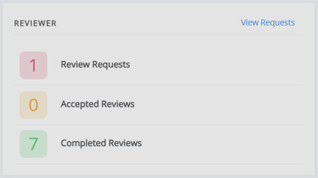
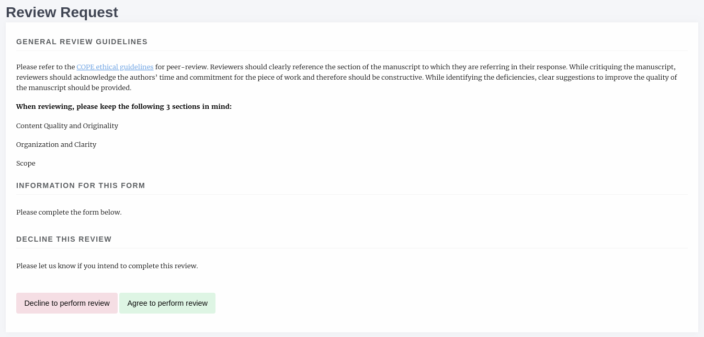
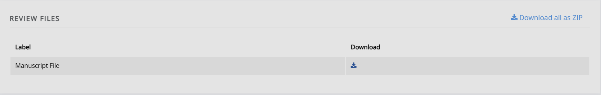
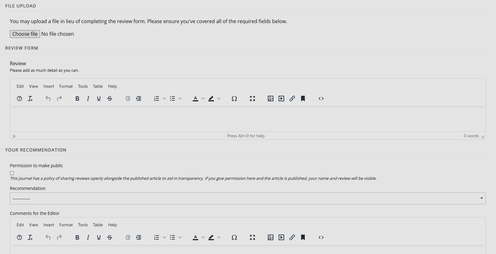

# Reviewer guide

This guide is for reviewers who have been invited to review an article through Janeway.

## Access your review task

You can access your review task in two ways:

1. Using the direct link in the review request email.
2. Through the **Reviewer** block on your Janeway dashboard.

### Direct link

If the journal has turned on one-click review access, the link in your review invitation takes you straight to the review page. You don't need to sign in. Otherwise, you need to sign in as usual.

> [!NOTE]
> Do **not** share your link! This link is generated specifically for you and your review task. It functions like a password. If you share it, someone else can access your review task under your name and credentials.

### Dashboard

If you sign in to Janeway as a reviewer, you will see the **Reviewer** block on your dashboard. Here, you can see active review requests, accepted review requests, and any reviews you have completed.

If you have any other roles within a journal, such as author or editor, you will also see blocks for these on your dashboard.

To see your review requests, select **View requests**. See [Review requests](#review-requests).

## Review requests

The **Review Requests** page lists your review tasks. New requests are under **Awaiting initial decision**, and tasks you have accepted are under **Reviews in progress**. Each task shows the article's title, the due date and the editor's initials.

- To see more about the article, such as its abstract and keywords, select **View Detail**.
- To accept the task, select **Accept Task**.
- To decline the task, select **Decline Task**.

## Completing your review

If you accept the task, you will be taken to the page for this review. It is split into three sections:

1. General review guidelines
2. Review files
3. Review form

### General review guidelines

This section displays information on how the editor would like you to undertake the review, an introduction to the review form, and metadata.

> [!NOTE]
> This section may include both general review guidelines and guidelines specific to this review. These can differ depending on the journal and the type of submission. Read through these even if you've reviewed a paper for this journal before, as they may not be the same as for a previous review task.

At the bottom of this block, you will find another option to accept or decline this review task. If you initially accepted the task but are no longer available, decline it here so that it can be offered to someone else. If you opt to decline to review, you will be asked if you can suggest other suitable reviewers. This is optional, but highly encouraged.

### Review files

The files the editor has selected for you to review are listed here. There might be multiple files (e.g. supplementary files), so this block includes the option to download them all as a ZIP file.

### Review form

This is where you will complete your review. What this looks like will differ from journal to journal, but the main sections will be the same. Each element in the form will be accompanied by a title or description to assist you in completing it.

The sections of this form are:

- **File upload**  
   You can upload your review here if you prefer to complete it offline (e.g. by writing down your feedback in a Word document). This section may be disabled, in which case, it will not appear.

- **Review form**  
   This is where you will complete your review. The form may consist of a single text box or be composed of multiple boxes, which can include checkboxes and dropdowns. This will depend on the individual journal, but each part will be accompanied by text that explains what they are looking for.

- **Your recommendation**  
   This will be divided into two subsections: **Decision** and **Comments for the editor**.

- **Decision**  
   You may select one of the following options for your recommendations: - Accept without revisions - Minor revisions required - Major revisions required - Reject

- **Comments for the editor**  
   If you have additional comments, they can be added here. These will be visible only to the editor(s), although they may choose to share them with the author.

## Review complete

Once you have submitted your review, you will be presented with an overview of what you have written. Note you will not be able to return to the review page or edit what you have written once you have clicked **Submit**.
