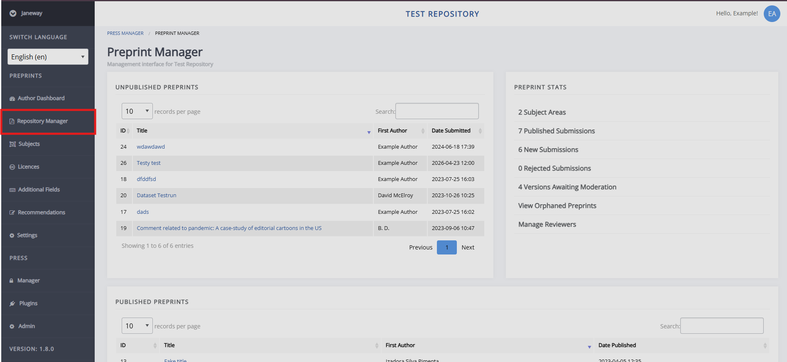
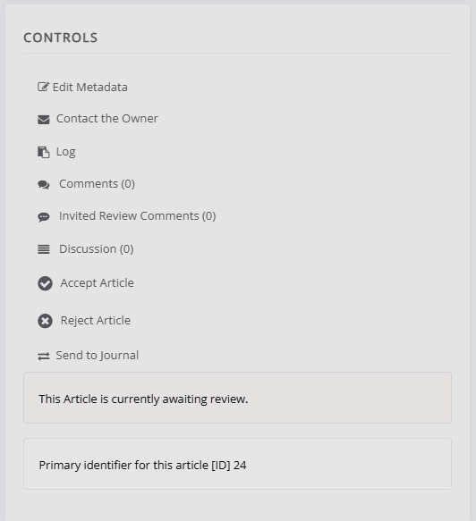
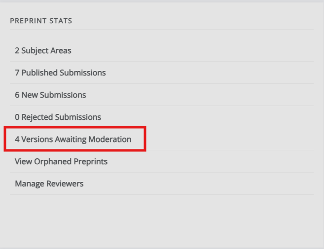
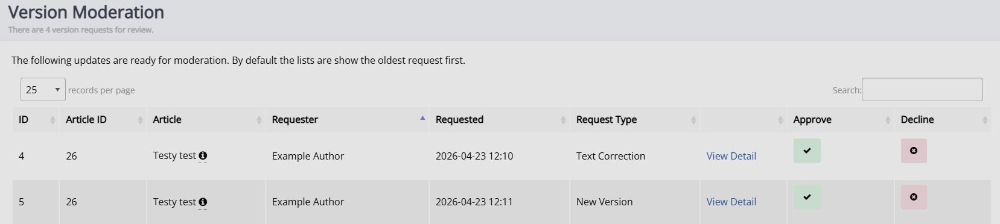

# Moderator guide

As a moderator you can find (un)published preprints and preprint stats in the Repository manager, accessible from the left navigation menu.

## Published preprints

Click the title of a preprint to go to the preprint dashboard. Here, you can view the preprint's metadata, (supplementary) files, versions, and the control panel.

### Controls for published preprints

- Edit metadata
- Contact the owner  
   Lets you contact the primary author of the preprint by email. You can include attachments and BCC other recipients.
- Log  
   Opens a log of all emails sent from the system about this preprint.
- Comments  
   Displays comments made on the published preprint. From here, you can review, publish, and delete them.
    <!--What does "review" do, practically? It moves it to old, but how would it impact users? -->
- Invited review comments  
   From here, you can invite reviews, see active reviews, and see declined and withdrawn reviews. To send a review invitation, the recipient must first be added as a reviewer — either through **Manage reviewers** on the Repository Manager page, or by clicking **Manage reviewers** on the review invitation screen.
- Discussion  
   Lets you view and comment on internal discussion threads, and open new ones. <!--Can the author(s) see these?-->
- Edit published date
- Un-published this article
- Send to journal  
   Lets you send the preprint to a journal on the Janeway press. Select the licence, section (article type), and the stage to send it to.

## Unpublished preprints

Similar to published preprints, click the title of an unpublished preprint in the Repository Manager to go to the preprint page. On this page, you can review the (supplementary) files and metadata.

If the preprint is suitable after initial review, click **Create a version with this file**. After this, you can invite reviewers and take other actions to process the preprint. To reject the preprint, select **Reject article** in the control panel. An email prompt opens, where you can explain your decision to the authors. When the preprint is ready for publication, click **Accept article** in the control panel and set a publication date.

### Controls for unpublished preprints

Similar to published preprints, the control panel displays the preprint's status and primary identifier, and presents various options. These are the same as those for published preprints, except that **Edit published date** and **Unpublish this article** are replaced with **Accept article** and **Reject article**.

## Moderating new versions

On the Repository manager, in the Stats block, click **Versions awaiting moderation**.

This displays a list of all versions awaiting moderation and their request type.
Click **View detail** to review the version. Then click **Accept** or **Decline** to record your decision.

# Rejected and orphaned preprints

Rejected and orphaned preprints can be found through the preprint manager, in the **Preprint stats** block.

- **Rejected submissions**  
  Lists preprints that have been rejected, with the date each was submitted and rejected.

- **Orphaned preprints**  
  Lists preprints that have no subject, for example because their subject was deleted. Open each one and give it a subject, so it appears in the repository's subject lists.

## Handling review comments

Invited review comments are reviews that moderators request from chosen reviewers. You can publish a completed review on the preprint's page, where it appears with the reader comments.

The **Invited review comments** option and the **Reviewers** page only appear when invited comments are turned on for the repository. They are on by default.

### Adding reviewers

Reviewers must have the reviewer role on the repository before you can invite them.

1. In the **Repository manager**, under **Preprint stats\*, select **Manage reviewers\*\*.
2. Search for a user by first name, last name or email address.
3. Next to the user, click **Add role**.

To remove someone, click **Remove role** next to their name under **Current reviewers**.

### Inviting a reviewer

1. Open the preprint from the **Repository manager**.
2. In the control panel, click **Invited review comments**.
3. Click **Add new invite** in the top-right corner.
4. Under **Select a reviewer**, choose the reviewer. If they aren't listed, select **Manage reviewers** to add them first.
5. Under **Set due dte**, set the date the review is due, then click **Complete step 1**.
6. If required, you can edit the email to the reviewer. You can also attach files.
7. Click **Send** to email the reviewer, or **Skip** to create the invitation without sending an email.

### Follow a review

The **Invited review comments** page of the preprint lists active invitations under **Invited reviewers**, and declined and withdrawn ones under **Inactive invited reviewers**. Open an invitation by clicking **View review detail** to see its details and controls. Depending on its status, you can:

- **View review detail**: see the form the reviewer completes.
- **Mark as accepted**: record that the reviewer has accepted the invitation.
- **Withdraw review**: cancel the invitation. Add a reason, which is sent to the reviewer.
- **Notify reviewer**: send the invitation email, if you skipped it when you created the invitation.
- **Update due date**: change the due date.
- **Reset and reopen review**: reopen a review the reviewer closed.
