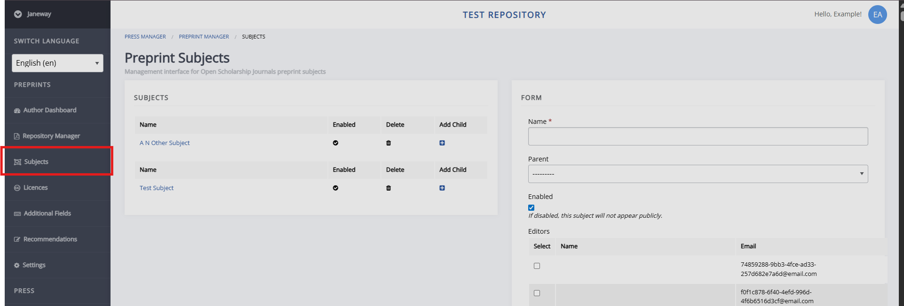
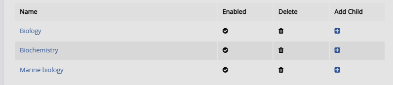
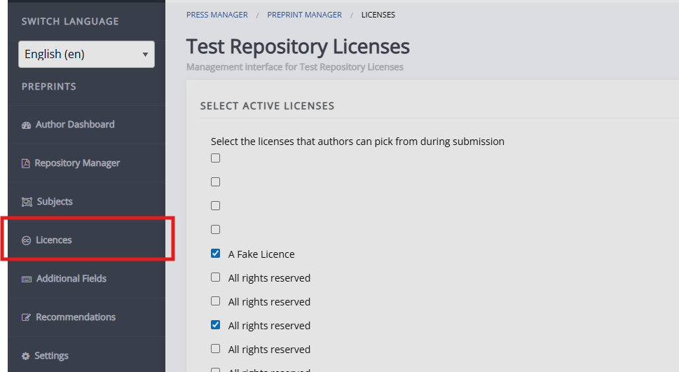
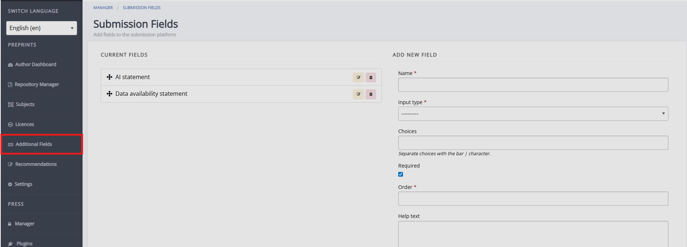
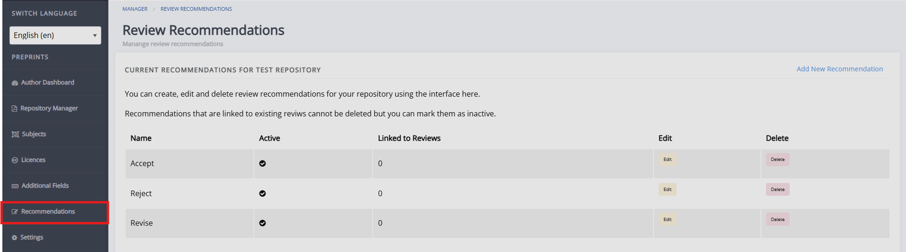

# Repository settings

Clicking **Repository settings** opens the repository setup wizard, which is used for both configuring a new repository and editing the settings of an existing one.

The wizard has five steps:

1. **Repository details 1**
   Key repository details, such as the name, custom domain, and the name of the objects in the repository (for example, "article" or "preprint"). Help text is available on the page.

2. **Repository details 2**
   Provides more detailed repository information, including the repository description and images, and review guidance for users.

3. **Submission details**
   Text shown to users on the submission page, and settings related to review.

4. **Email templates**
   Displays the email templates available on the repository. For more
   information on editing email templates and email template variables,
   see [Email templates](../email-and-reminders/email-templates.md). <!-- do we have a full list of repo email template vars? -->

5. **Live**
   Sets the repository as live.

## Configuration pages

The repository sidebar holds several pages you use to set up the repository. This section describes them in the order they appear in the sidebar.

### Subjects

Subjects are the topics that preprints can fall into. You can organize them hierarchically, with child subjects; for example, "Biology" and "Marine biology". Child subjects are listed under their parent subject.

For each subject, you can also select editors who will be notified of submissions made to this subject. To hide a subject from the public site without deleting it, clear the **Enabled** tickbox.

> [!WARNING]
> If you delete a subject, preprints in that subject lose it and if this is the only subject they have, become orphaned. Moderators can find them under **Orphaned preprints**. See [Moderator guide](./moderator-guide.md#rejected-and-orphaned-preprints).

### Licences

This page lets you choose which licences are made available for preprints in this repository. Select the licences, then select **Save active licenses**. The available licences are all of those made available on the Janeway press, which is why you may see duplicates.

### Additional fields

You can set up additional, custom submission fields for your repository on this page. For each field, you can choose:

- Its name
- The type of input, such as a text box or a drop-down list. For a list, separate the choices with the "|" character.
- Whether the field is required.
- The order in which any additional fields should display. They can also be reordered using the drag-and-drop list at the top of the page.
- The field's helptext, to help authors when providing information for it.
- Whether its answer is displayed on the preprint's page.
- Dublin Core (DC) metadata type, if the field is to be output as a DC metadata field, its type can be specified here.

### Recommendations

Recommendations are the options invited reviewers choose from when they submit a review comment. You can create, edit, and delete review recommendations for your repository using the interface here. Only active recommendations are offered to reviewers. See [Handling review comments](./moderator-guide.md#handling-review-comments).

### Settings

Opens the repository setup wizard, described at the top of this page.
