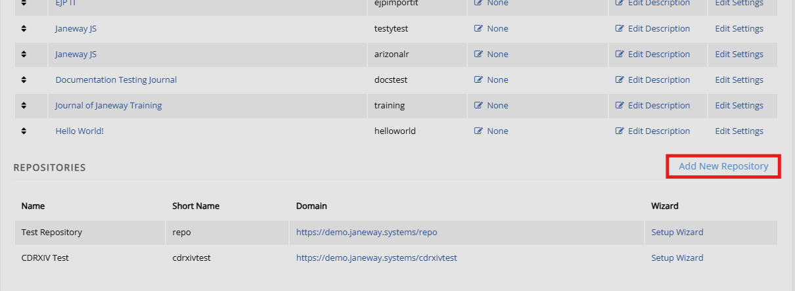

# Setting up a repository with Janeway

## About Janeway repositories

Janeway supports hosting repositories for preprints, postprints, field reports, and other publication types within the same press environment as journals.
 
A Janeway repository has its own website, settings and moderators, separate from the press's journals. It includes the following features:
 
- Item names  
  You choose what the items in the repository are called, for example "preprint" or "field report". Janeway uses this name throughout the repository.

<!-- - Submission types  
  Authors choose what kind of item they are submitting. Each type has its own label on the public site.
  
  I think this is for 1.9. Keeping it as a comment -->

- Versions and moderation  
  Moderators check each submission before it is published. Authors can then submit corrections, new versions and metadata corrections, which moderators approve before they go live.

- Reader comments and invited reviews  
  Readers can comment on published items, and moderators can invite reviewers to comment. Comments and reviews appear publicly only after a moderator approves them.

<!-- - Subjects and organisational units  
  Subjects group items by topic, and organisational units group them by part of an organisation, for example "Research" or "Publications". Both can be hierarchical. This is also 1.9, based on my notes-->

- Links to journals  
  Moderators can send an item to a journal on the same press. See [Linking a repository and journal](./linking-a-repository-and-journal.md).

For how to configure each of these, see [Repository settings](./repository-settings.md).

## Navigating the Janeway repositories

### Repository manager

You can view unpublished preprints, preprint stats and published preprints.

### Preprint stats

- High-level stats overview
- From here you can navigate to rejected preprints, versions awaiting moderation, orphaned preprints, and the reviewer management page.

## Getting started

The first step is to enable the repository system in the press-level
settings:

1.  Go to the **Press manager**.
2.  Open **Edit press details**.
3.  Tick the **Enable repository system** box and click **Save**.
4.  Return to the **Press manager**.
5.  The **Add a new repository** option appears below the list of journals.
    Click it.  
    
6.  This opens the repository set-up wizard. See [Repository settings](./repository-settings.md) for more information.

## Other settings

Once the repository exists, you can configure it through the various options in the repository sidebar. This includes subjects, licences and recommendations. See [Repository settings](./repository-settings.md). For information on linking a journal and repository, see [linking repositories](./linking-repository-journal.md).
