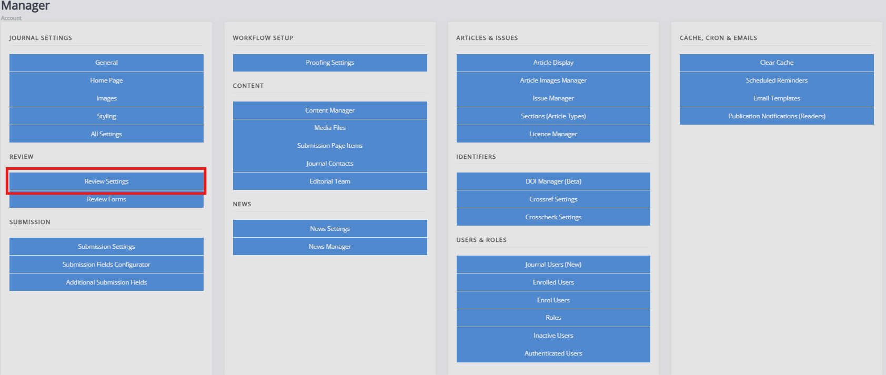

# Review settings

Review settings control how peer review works on your journal. This page describes each setting in the order it appears on the **Review settings** page.

## Open the review settings

1. Open the **Manager** dashboard in either of the following ways:
   - In the sidebar, under **Staff**, select **Manager**.
   - Select your account icon in the top-right corner, then select **Manager**.
2. In the **Review** panel, select **Review settings**.
3. Change the settings you need, then select **Submit**.

## Settings

### Review file help

Text shown to reviewers when a review is single anonymous or double anonymous. Use it to remind reviewers to keep any files they upload anonymous.

### Default review form

The review form selected by default when an editor assigns a reviewer. See [Review forms](./review-forms.md). This can be still be changed to another form when assigning a review.

### Default number of days for review

The number of days a reviewer has to complete a review. Janeway uses it to set the due date and to time reminders. Editors can change the due date when they assign a reviewer.

Default: 56 days (8 weeks).

### Default review anonymity

The anonymity option selected by default when an editor assigns a reviewer. Editors can change it for each review. The options are:

- **Open**: authors and reviewers can see each other's names.
- **Single Anonymous**: reviewers can see the authors' names, but authors can't see the reviewers' names.
- **Double Anonymous**: neither can see the other's name. Editors must make sure the manuscript files are anonymized.

Janeway will by default be set to double anonymous. To set up triple anonymous review, see [Triple anonymous peer review](./triple-anonymous-peer-review.md).

### Enable one-click review access

When this is on, the link in the review request email includes a unique access token. Reviewers can use the link to open and complete their review without signing in. The token is removed when the review is complete, so the link can't be reused.

Default: on.

### Draft decisions

When this is on, section editors can't make a decision after review. Instead, they draft a decision for a senior editor to review. See [Editor guide to draft decisions](../guides/editor-guide-to-draft-decisions.md).

### Enable suggested reviewers

When this is on, the page for assigning a reviewer suggests reviewers whose interests match the article's keywords.

> [!WARNING]
> Matching keywords with interests uses a lot of server resources. It can slow down the reviewer assignment page.

### Enable open peer review

When this is on, each review can be published alongside its article. The reviewer and the editor must both approve a review before it is made public. See [Open peer review](./open-peer-review.md).

### Open review defaults to opt in

When this is on, reviewers opt in to open peer review by default and they would need to opt out when completing the review.

### Reviewer guidelines

General guidelines that reviewers follow when they review for your journal. Reviewers see them at the top of every review assignment.

### Enable save review progress

When this is on, reviewers can save a review and come back to finish it later. This is only recommended for journals with long custom review forms.

### Disable reviewer recommendation

When this is on, reviewers will not be asked to make a recommendation (e.g. "Accept", "Reject" or "Revisions"). The recommendation will be set to "No recommendation".

### Review form download

When this is on, reviewers can download a copy of the review form to complete offline.

### Peer review upload text

Text shown above the **File upload** box on the review form. Reviewers use this box when they upload their review as a file instead of completing the form.

### Enable expanded review details

When this is on, the editor's review page shows every active review. When it is off, it shows a count of completed reviews.

Default: on.

### Hide review data from authors before release

When this is on, authors can't see any review data until the end of the review stage. Reviews that an editor shares with the author during review are the exception.

Default: on.

### Enable peer review data on author page

When this is on, authors see the date each review was requested, is due and was completed, on their author page.

### Enable peer review data on review pages

When this is on, authors see the date each review was requested, is due and was completed, on review pages.

### Automatically share author response letters

When this is on you share reviews among reviewers, then Janeway will include any reviewer response letters when sharing the reviews.

### Accept article warning

Text shown to editors before they accept an article. If your journal registers DOIs with Crossref, you can use it to remind editors that accepting starts DOI and metadata registration. You can also use it to show the current metadata, so editors can check what will be sent to Crossref.

<!-- ### Default review visible to author

When this is on, completed reviews are visible to authors by default. Editors can still change this for each review. See [Sharing reviews](./sharing-reviews.md). -->
