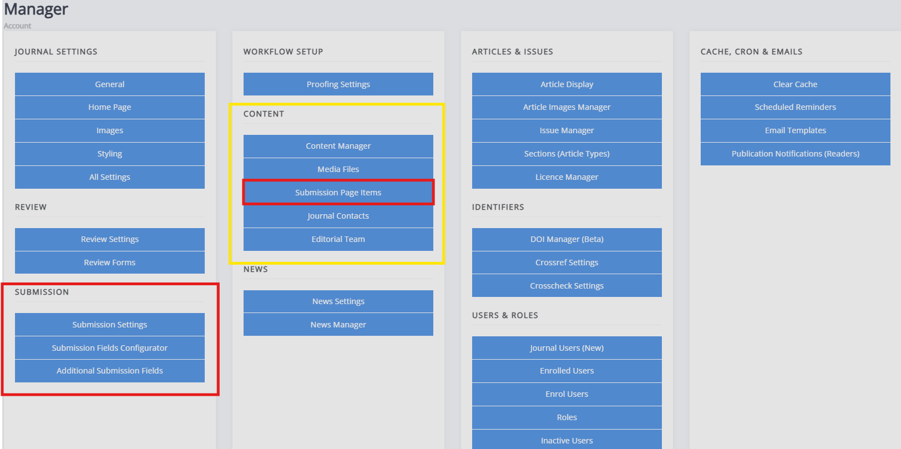

# Managing submissions on Janeway

Managing submissions on Janeway has two parts:

- The submission information page  
  A public page on the journal website, at `[yourjournalwebsite]/submissions`. It tells potential authors what the journal accepts and how to submit.

- The submission process  
  The step-by-step form authors complete in Janeway to submit a manuscript and give information about it.

Some information appears in both places by default, such as the copyright notice, publication fees and the submission checklist. These items are crosslinked: you can edit them through **Submission page items** or **Submission settings**, and a change in one place updates both. Authors therefore see the same information on the website and in the submission process. See [Crosslinked submission page items](./configuring-the-submission-page.md#crosslinked-submission-page-items).

The pages below are organized by what you need to do, not by the order of the buttons. Each item names the button that opens it on the **Manager** dashboard. Three of the buttons are in the **Submission** block. **Submission page items** is in the **Content** block.

- [Configuring the submission page](./configuring-the-submission-page.md)  
  This configures the text on the submission information page (`[yourjournalwebsite]/submissions`). Open it by clicking **Submission page items**, though some parts can also be edited through **Submission settings**.

- [Submission settings](./submission-settings.md)  
  This configures the submission process itself and how it functions. From here, you can also disable submissions. Open by clicking **Submission settings**.

- [Managing submission fields](./managing-submission-fields.md)  
  Choose which standard fields authors see during the submission process. Open it by clicking **Submission fields configurator**. Fields you untick aren't shown to authors. If you turn off the licence, language or section (article type) fields, you must set a default value for each one. Janeway then adds that default to the article metadata. If a field is turned off and has no default, the article metadata won't include that information.

- [Custom submission fields](./managing-submission-fields.md#custom-submission-fields)  
  If you require any additional submission fields as part of the submission process, you can set them up through this page. Open it by clicking **Additional submission fields**.

Other relevant settings you may configure related to submissions are the [**Licence manager**](./licence-manager.md), which configures the licences available for your journal, and [**Sections**](../article-management/article-sections.md), which sets the article types available for the journal and submissions.
